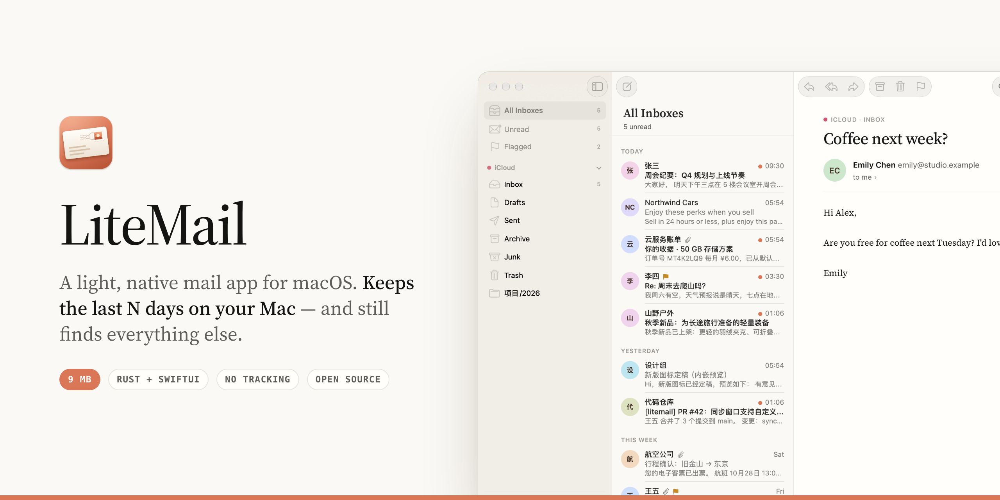
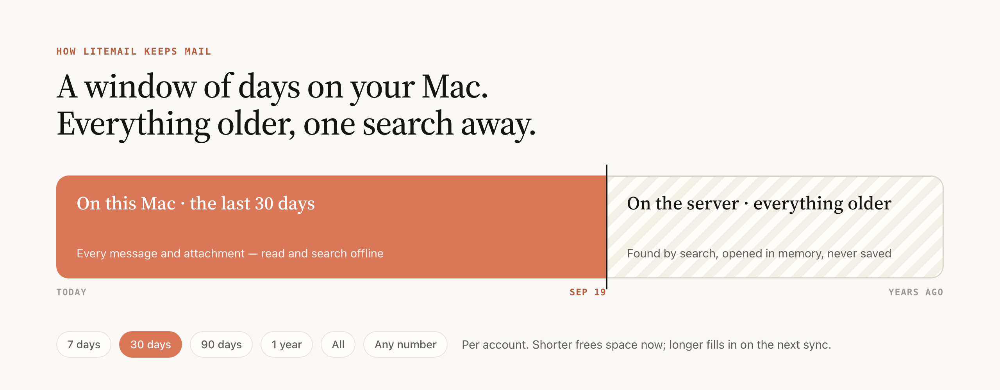
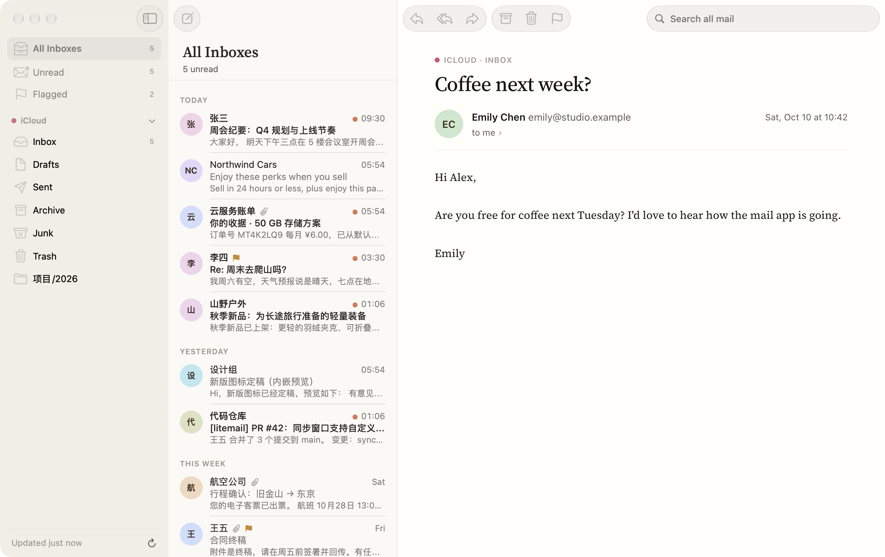
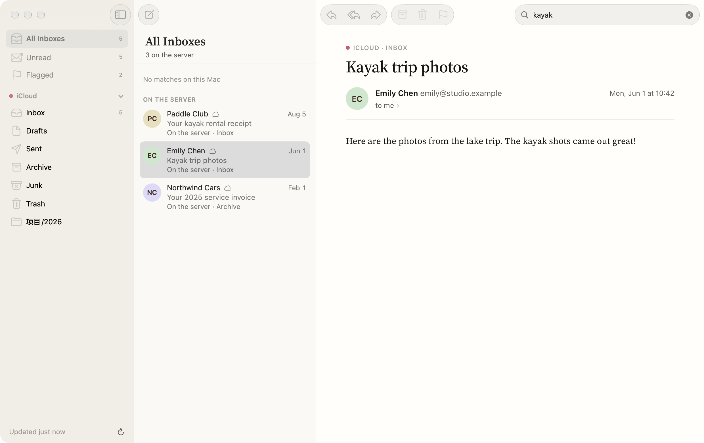
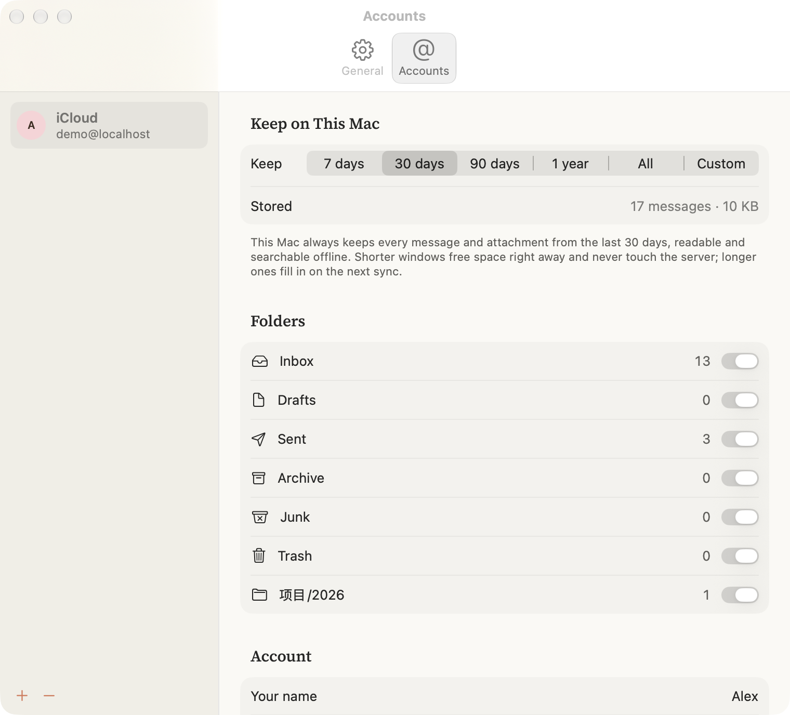

<p align="center">
  
</p>

<p align="center">
  
  
  
  
  <a href="LICENSE"></a>
</p>

## Why LiteMail

Most mail apps either download your whole mailbox or keep nothing offline. LiteMail does one
thing differently: **you choose a window — 7, 30, 90 days, a year, everything, or any number of
days — and your Mac keeps every message and attachment inside it**, readable and searchable
offline. Everything older stays on the server, one search away.

<p align="center">
  
</p>

## Features

**Your mail, on your terms**
- **Keep the last N days.** Per account. Shorter windows free space immediately and never touch
  the server; longer ones fill in on the next sync.
- **Search everything — even what isn't here.** Full-text search on this Mac (Chinese included,
  with `from:` `to:` `subject:` `has:attachment` `is:unread` `is:flagged` and quoted phrases),
  plus the server for anything older. Older results open in memory and are never saved.
- **Push and offline.** IMAP IDLE delivers new mail instantly; archive, delete, flag or move
  while offline and LiteMail replays it when you're back.

**Small, fast, native**
- **A 9 MB app.** A Rust core (sync, storage, MIME, search, SMTP) under a SwiftUI interface.
  No Electron, no web views for the UI.
- **Quiet design.** Warm paper neutrals, one terracotta accent, Source Serif 4 for reading.
  Light and dark. English and 简体中文.

**Private by default**
- **No tracking pixels.** Remote images are blocked until you ask — shown as calm placeholders,
  not broken frames — and JavaScript in email never runs.
- **Nothing leaves your Mac** except to your own mail servers. No LiteMail server, no analytics.
  Passwords live in the macOS keychain.
- **Reading old mail is invisible.** Opening a server search result doesn't mark it read.

**Works with what you have**
- **iCloud, Gmail and any IMAP account** (QQ, 163/126, Yahoo, Fastmail, Zoho and more are
  pre-filled).
- **Send from any of your addresses.** Aliases you add, ones LiteMail finds in your Sent folder,
  and iCloud's @icloud.com twin. Replies go out from the address a message was sent to.
- **The little things.** Unified inbox, smart Unread and Flagged mailboxes, reply all without
  copying yourself, signatures, drag-and-drop attachments, notifications and Dock badge,
  default `mailto:` handler.

<p align="center">
  <picture>
    <source media="(prefers-color-scheme: dark)" srcset="docs/images/dark.png">
    
  </picture>
  <br><sub>Light or dark, following your Mac — this picture follows your GitHub theme</sub>
</p>

<table>
  <tr>
    <td width="50%"></td>
    <td width="50%"></td>
  </tr>
  <tr>
    <td align="center"><sub>Older mail is found on the server and opened in memory</sub></td>
    <td align="center"><sub>Choose how much mail lives on this Mac</sub></td>
  </tr>
</table>

## Accounts

| Provider | What to enter |
| --- | --- |
| iCloud | Your address and an **app-specific password** from account.apple.com → Sign-In and Security |
| Gmail | Your address and an **app password** from myaccount.google.com/apppasswords (needs 2-Step Verification) |
| Other IMAP | Server settings are filled in for common providers; anything else works too |

Outlook.com only allows OAuth sign-in for third-party apps and isn't supported yet.

## Build

Requirements: macOS 26+, Xcode 26+, Rust (`brew install rustup && rustup default stable`).

```bash
scripts/build-app.sh            # → build/app.noindex/LiteMail.app
scripts/build-app.sh --install  # also copies it to ~/Applications
```

`build-app.sh` builds the Rust core, regenerates the UniFFI Swift bindings and the
`litemail_coreFFI.xcframework`, builds the SwiftUI app, renders the icon and signs the bundle
with your Developer ID (or Apple Development) certificate if you have one, ad-hoc otherwise.

## Tests

```bash
scripts/test.sh
```

Runs the Rust unit tests, end-to-end tests against a real IMAP server (Dovecot) and an SMTP sink
on 127.0.0.1, and the Swift tests. The test servers live in `Tools/testserver/` (`run.sh
start|stop`); `seed_demo.py` fills a demo mailbox, and `Tools/run-test-app.sh` + `Tools/ui.sh`
drive the real app through a test-only automation channel for screenshots.

## How it's built

```
core/      Rust: imap.rs (strict command runner), sync.rs (one worker per account, IDLE),
           store.rs (SQLite + FTS5 trigram), server_search.rs, mime.rs, reader.rs,
           compose.rs, smtp.rs, secrets.rs (keychain), i18n.rs
app/       SwiftUI app, Resources/*.lproj, Fonts/ (Source Serif 4, SIL OFL)
scripts/   build-core.sh, build-app.sh, test.sh
Tools/     test servers, icon renderer, string extractor, UI automation helpers
```

Mail lives in `~/Library/Application Support/LiteMail` (`mail.db` + raw `.eml` files).
[`AGENTS.md`](AGENTS.md) records every trap we hit and the rule that came out of it — read it
before changing sync, search or storage.

## Privacy

LiteMail collects no data. See [PRIVACY.md](PRIVACY.md).

## License

[MIT](LICENSE). Source Serif 4 is © Adobe, under the SIL Open Font License.
The interface and the graphics on this page were designed in Claude Design.

---

<details>
<summary><b>中文说明</b></summary>

<br>

LiteMail 是一个轻量的原生 macOS 邮件客户端，支持 iCloud、Gmail 和任意 IMAP 邮箱。

- **只保存最近 N 天**：每个账户可以选 7 / 30 / 90 天、1 年、全部或任意天数。这段时间内的全部邮件和附件都在本机，离线也能读、能搜；更早的留在服务器上。
- **搜得到不在本机的邮件**：本机全文搜索（支持中文）之外，还会去服务器搜更早的邮件；打开时只放在内存里，不写进本机。
- **小而快**：9 MB，Rust 内核 + SwiftUI 界面，没有 Electron。
- **默认保护隐私**：远程图片默认拦截，邮件里的 JavaScript 从不运行，没有任何统计；密码存在系统钥匙串。
- **用任意地址发信**：自己添加的别名、「已发送」里用过的地址、iCloud 自带的 @icloud.com 地址；回复时自动用对方发给你的那个地址。
- **界面**：暖色纸张底色、单一陶土橙强调色、Source Serif 4 阅读字体；浅色和深色；英文和简体中文。

构建：`scripts/build-app.sh --install`。测试：`scripts/test.sh`。

</details>
